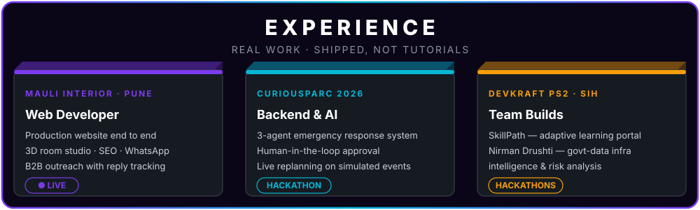
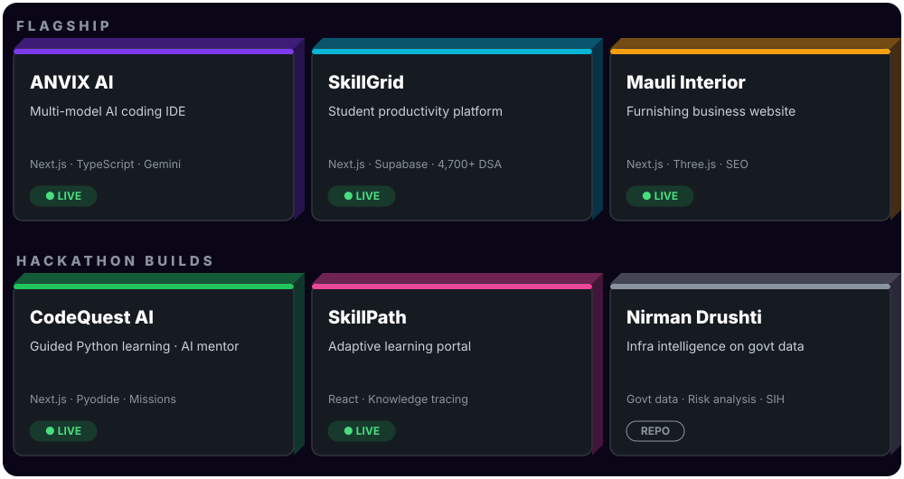
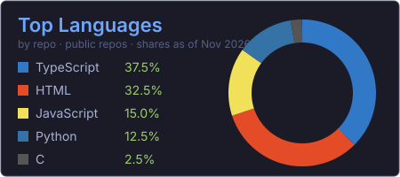
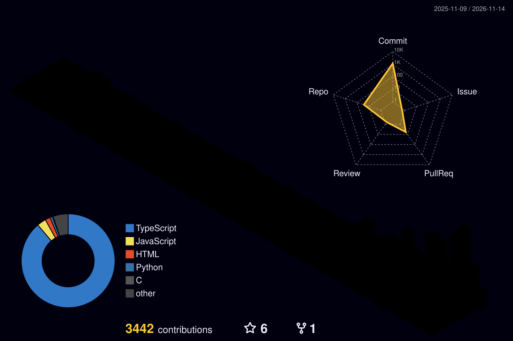
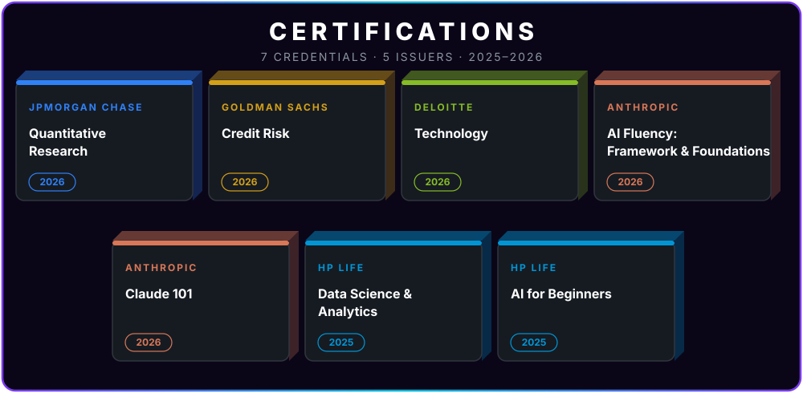

  

 

  

  

---

## About Me

Second-year AI &amp; DS student who ships real products end to end — not tutorial projects.

  

🔭 Currently building **SkillGrid** (student productivity platform — aptitude, company-DSA, mock interviews, friends & leaderboards) and **ANVIX AI** (AI coding IDE with workspaces and PostgreSQL).

💡 What I do: full-stack web products and AI systems — Next.js + TypeScript frontends, FastAPI/Supabase backends, and LLM-powered features that actually ship.

📫 **thiteswapnil1212@gmail.com** · 📞 +91 82088 11046

---

## Experience

  

**Web Developer — Mauli Interior, Pune** *(family furnishing business)*
- Designed, built, and shipped the production website end-to-end — Next.js with a Three.js 3D room studio, product & project showcases, full on-page SEO, and WhatsApp enquiry deep-links — [live site](https://mauliinterior-stores-web.vercel.app/)
- Run the business's online outreach too — B2B cold-email campaigns with reply tracking and follow-ups

**Backend & AI — CuriousPARC 2026 hackathon team**
- Built the backend and AI agents for an Adaptive Emergency Response system: 3 agents (Risk, Resource & Routing, Response Planning) + orchestrator, human-in-the-loop approval, and live replanning on simulated events

**Team Builds — Devkraft PS2 2026 & Smart India Hackathon**
- **SkillPath** (Devkraft PS2) — adaptive learning portal with concept maps, knowledge tracing, and a coding arena
- **Nirman Drushti** (SIH) — infrastructure intelligence on government data: project monitoring, cost intelligence, and risk analysis

---

## Skills & Tools

  

`Python` · `C` · `HTML` · `CSS` · `JavaScript` · `TypeScript` · `React` · `Next.js` · `Supabase` · `AI API Integration` · `OpenCV` · `MediaPipe`

🌱 Currently learning: `Java` · `DSA` · `OOP` · `SQL` · `Spring Boot` · `PostgreSQL`

---

## Projects

27 projects on GitHub — flagship products, hackathon builds, AI tools, and starter code. Live links checked 14 Nov 2026; the rest are repo-only.

  

### 🚀 Flagship

| Project | What it is | Live | Repo |
|---|---|---|---|
| **ANVIX AI** | AI coding IDE — workspaces, auth, PostgreSQL | [Live](https://anvix-ai.vercel.app/) | [Repo](https://github.com/thiteswapnil1212-hue/ANVIX-AI) |
| **SkillGrid** | Student productivity platform — academics, DSA, projects, habits, friends & leaderboards | [Live](https://skill-grid-weld.vercel.app/) | *private* |
| **Mauli Interior** | Family furnishing-business site — 3D room designer, showcases, WhatsApp enquiries | [Live](https://mauliinterior-stores-web.vercel.app/) | [Repo](https://github.com/thiteswapnil1212-hue/INTERIOR-STORES-WEB) |

### 🏆 Hackathon builds

| Project | What it is | Live | Repo |
|---|---|---|---|
| **CodeQuest AI** | Guided Python learning — missions, AI mentor, Pyodide execution (Vortexa) | [Live](https://codequest-xi-eight.vercel.app/) | [Repo](https://github.com/thiteswapnil1212-hue/codequest-ai) |
| **SkillPath** | Adaptive learning portal — concept maps, knowledge tracing (Devkraft PS2) | [Live](https://devkraft-black.vercel.app/) | [Repo](https://github.com/thiteswapnil1212-hue/skillpath) |
| **Nirman Drushti** | Infra intelligence on govt data — project monitoring, risk analysis (SIH) | — | [Repo](https://github.com/thiteswapnil1212-hue/nirman-drushti) |
| **cupric2026** | Adaptive Emergency Response — AI agents draft plans, human approval, live replanning (CuriousPARC 2026) | — | [Repo](https://github.com/thiteswapnil1212-hue/cupric2026) |

### 🤖 Apps & AI tools

| Project | What it is | Live | Repo |
|---|---|---|---|
| **Skill-Sathi** | Govt benefits checker — which schemes you qualify for (PS16) | [Live](https://scheme-sathi-rose.vercel.app/) | [Repo](https://github.com/thiteswapnil1212-hue/skill-sathi) |
| **Stocksense-AI** | AI assistant for stock trading analysis | — | [Repo](https://github.com/thiteswapnil1212-hue/Stocksense-AI) |
| **ai-photo-enhancer** | Single-page photo enhancement demo | — | [Repo](https://github.com/thiteswapnil1212-hue/ai-photo-enhancer) |
| **English-learning-app** | English learning app for students aged 4–7 | — | [Repo](https://github.com/thiteswapnil1212-hue/English-learning-app) |
| **Hill-climb-racing-controller** | GesturePilot — control games with bare hands (MediaPipe + OpenCV) | — | [Repo](https://github.com/thiteswapnil1212-hue/Hill-climb-racing-controller) |
| **VisionSwipe AI** | Touch-free hand-gesture control (MediaPipe + OpenCV) | — | [Repo](https://github.com/thiteswapnil1212-hue/visionswip) |

### 🏠 Mauli Interior — site drafts

| Project | What it is | Live | Repo |
|---|---|---|---|
| **interior-studio** | Earlier Mauli site prototype — superseded by INTERIOR-STORES-WEB | — | [Repo](https://github.com/thiteswapnil1212-hue/interior-studio) |
| **interiorstudio** | Interior site draft — no description yet | — | [Repo](https://github.com/thiteswapnil1212-hue/interiorstudio) |
| **website-interior-studio** | Mauli Interior shop site | — | [Repo](https://github.com/thiteswapnil1212-hue/website-interior-studio) |
| **developement-shop** | Interior store site (draft) | — | [Repo](https://github.com/thiteswapnil1212-hue/developement-shop) |
| **new-website-** | Website draft — no description yet | — | [Repo](https://github.com/thiteswapnil1212-hue/new-website-) |
| **developement** | Website draft — no description yet | — | [Repo](https://github.com/thiteswapnil1212-hue/developement) |

### 📚 Learning & tools

| Project | What it is | Live | Repo |
|---|---|---|---|
| **devlvlup** | Evidence-first career audit — scores repos on quality, architecture, testing, security, docs | — | [Repo](https://github.com/thiteswapnil1212-hue/devlvlup) |
| **DSA-project-** | Campus navigation in C — graph shortest-path routing | — | [Repo](https://github.com/thiteswapnil1212-hue/DSA-project-) |

### 🧰 DripCode Build Projects — starter code

Starter repos — structure + README only, no solution code.

| Project | What it is | Live | Repo |
|---|---|---|---|
| **dripcode-starter-flask-microblog** | Flask Microblog starter (Python + Flask) | — | [Repo](https://github.com/thiteswapnil1212-hue/dripcode-starter-flask-microblog) |
| **dripcode-starter-todo-app** | Todo App starter (vanilla JS + LocalStorage) | — | [Repo](https://github.com/thiteswapnil1212-hue/dripcode-starter-todo-app) |
| **dripcode-starter-ecommerce-store** | E-commerce Store starter (React + Context API) | — | [Repo](https://github.com/thiteswapnil1212-hue/dripcode-starter-ecommerce-store) |
| **dripcode-starter-conduit** | Conduit / Medium clone starter (React + RealWorld API) | — | [Repo](https://github.com/thiteswapnil1212-hue/dripcode-starter-conduit) |
| **dripcode-starter-chat-app** | Chat App starter (React + Node + Socket.io) | — | [Repo](https://github.com/thiteswapnil1212-hue/dripcode-starter-chat-app) |
| **dripcode-starter-trello-clone** | Trello Clone starter (React + Strapi) | — | [Repo](https://github.com/thiteswapnil1212-hue/dripcode-starter-trello-clone) |

Also built: **Smart Cinema (CEPL)** — seat booking + QR ticket verification + admin dashboard + Arduino IR-sensor demonstrator; patent Form 2 drafted (inventor). Repo deleted, so no link.

Private, no public link: hacklthonbackend, AI-infracture, SIH-project-, Smart-india-final-repo — hackathon backends.

---

## Contributions

  
  

---

## GitHub Activity

<picture>
  <source media="(prefers-color-scheme: dark)" srcset="./profile-3d-contrib/profile-night-rainbow.svg">
  <source media="(prefers-color-scheme: light)" srcset="./profile-3d-contrib/profile-season.svg">
  
</picture>

---

## Certifications

  

- **JPMorgan Chase** — Quantitative Research Job Simulation (2026) — `FYjX368nh6AJkgBiP`
- **Goldman Sachs** — Credit Risk Job Simulation (2026) — ID not listed (LinkedIn wrongly shows Deloitte's ID there)
- **Deloitte** — Technology Job Simulation (2026) — `698a02ac22bd8ef07d9885ce`
- **Anthropic** — AI Fluency: Framework & Foundations (2026) — `akfyr22eegfb` · Claude 101 (2026) — `aa34ifgqyq58`
- **HP LIFE** — Data Science & Analytics (2025) — `6614150f-45b9-4668-bc26-0f80b0768d74` · AI for Beginners (2025) — `5ba2ee3-eca9-4718-861d-d6f29a25223d`

---

## Achievements

  

🦈 **Pull Shark** — merged pull requests · 🚀 **YOLO** — merged a PR with no review

---

*Thanks for visiting — let's build something useful together.*

