  

 

 

---

## About Me

  

### Experience

**Web Developer — Mauli Interior, Pune** *(family furnishing business)*
- Designed, built and shipped the production website — Next.js, Three.js 3D room studio, SEO, products & projects showcase
- Real users, real business — not a tutorial project

### Education

**DY Patil Institute of Technology, Pimpri, Pune** — B.E. AI & Data Science, 2025–2029

---

## Skills & Tools

  

`Python` · `C` · `HTML` · `CSS` · `JavaScript` · `TypeScript` · `React` · `Next.js` · `AI API Integration` · `OpenCV` · `MediaPipe`

🌱 Currently learning: `Java` · `DSA` · `OOP` · `SQL` · `Spring Boot` · `PostgreSQL`

---

## Projects

### Mauli Interior Website — Web Developer *(family furnishing business, Pune)*

- Designed, built, and shipped the production website end-to-end for Mauli Interior, a real furnishing business in Pune.
- Interactive 3D room studio (Three.js) where customers visualize rooms, plus products and projects showcases built with Next.js.
- Full on-page SEO, WhatsApp enquiry deep-links, and performance tuning for real customer traffic.
- A live business asset — real users, real visibility, not a tutorial project.
- [Live Site](https://mauliinterior-stores-web.vercel.app/) · [Repository](https://github.com/thiteswapnil1212-hue/INTERIOR-STORES-WEB)

  

**ANVIX AI** [Live](https://anvix-ai.vercel.app/) · [Repo](https://github.com/thiteswapnil1212-hue/ANVIX-AI) &nbsp;|&nbsp; **CuriousPARC 2026** [Live](https://cupriouspark.vercel.app/) · [Repo](https://github.com/thiteswapnil1212-hue/cupric2026) &nbsp;|&nbsp; **Nirman Drushti** [Live](https://frontend-pearl-delta-28.vercel.app/) · [Repo](https://github.com/thiteswapnil1212-hue/nirman-drushti) &nbsp;|&nbsp; **VisionSwipe AI** [Repo](https://github.com/thiteswapnil1212-hue/visionswip) &nbsp;|&nbsp; **Mauli Interior** [Live](https://mauliinterior-stores-web.vercel.app/) · [Repo](https://github.com/thiteswapnil1212-hue/INTERIOR-STORES-WEB) &nbsp;|&nbsp; **SkillGrid** [Repo](https://github.com/thiteswapnil1212-hue/skillGrid) &nbsp;|&nbsp; **English Learning App** [Live](https://english-learning-app-eight-zeta.vercel.app/) · [Repo](https://github.com/thiteswapnil1212-hue/English-learning-app) &nbsp;|&nbsp; **Stocksense-AI** [Repo](https://github.com/thiteswapnil1212-hue/Stocksense-AI) &nbsp;|&nbsp; **AI Agents Workshop** [Repo](https://github.com/thiteswapnil1212-hue/ai-agents-workshop) &nbsp;|&nbsp; **GesturePilot AI** [Repo](https://github.com/thiteswapnil1212-hue/Hill-climb-racing-controller) &nbsp;|&nbsp; **AI Photo Enhancer** [Repo](https://github.com/thiteswapnil1212-hue/AIphotoenhancer-)

---

## Contributions

  
  
   
  

---

## GitHub Activity

<picture>
  <source media="(prefers-color-scheme: dark)" srcset="https://raw.githubusercontent.com/thiteswapnil1212-hue/thiteswapnil1212-hue/output/snake-dark.svg" />
  <source media="(prefers-color-scheme: light)" srcset="https://raw.githubusercontent.com/thiteswapnil1212-hue/thiteswapnil1212-hue/output/snake.svg" />
  
</picture>

 

<picture>
  <source media="(prefers-color-scheme: dark)" srcset="./profile-3d-contrib/profile-night-rainbow.svg">
  <source media="(prefers-color-scheme: light)" srcset="./profile-3d-contrib/profile-season.svg">
  
</picture>

---

## Certifications

  

---

*Thanks for visiting — let's build something useful together.*

